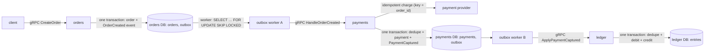

# Ledgerline

Event-driven orders, payments and a double-entry ledger in Go, built so that **a payment is never charged twice and
no ledger entry is ever lost**, even when services are killed mid-request. No message broker: a **transactional
outbox** in PostgreSQL and **idempotent consumers** give effectively-once processing.

> Work in progress: results (chaos test, k6 load test, Jaeger trace) are being measured and will be added here.

## How it works

1. **Transactional outbox.** A service writes its business change and an "event happened" row into its `outbox` table
   **in the same transaction**: both are saved or neither is.
2. **Outbox worker.** Claims unsent rows with `SELECT … FOR UPDATE SKIP LOCKED` (several workers can share one outbox
   without delivering the same row at once), calls the next service over gRPC, marks the rows sent, commits. If it dies
   before committing, the locks are released and the rows are delivered again: **at-least-once**.
3. **Idempotent consumers.** Every event has a unique `event_id`. The receiver inserts it with
   `INSERT … ON CONFLICT DO NOTHING` in the same transaction as its own change; a second delivery inserts nothing and
   changes nothing. At-least-once delivery + idempotent consumers = **effectively-once** processing.
4. **No double charge.** The payment provider (simulated) is idempotent on the order ID, like real card processors'
   idempotency keys: asking again, after a crash or a lost reply, returns the original charge.

## License

MIT
